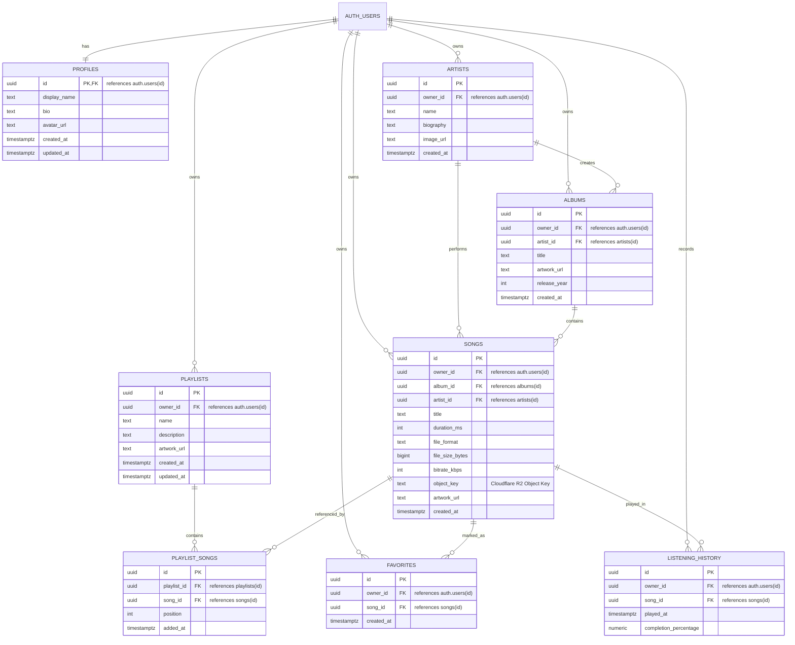

# Echo Database Schema & Architecture

This document details the PostgreSQL database architecture, data models, constraints, and Row Level Security (RLS) model designed for **Echo**, a personal, private Android music player.

---

## 1. Architecture & Design Principles

1. **Strict User Isolation**: Echo is private by design. Every music asset (songs, artists, albums, playlists, favorites, listening history) is owned by an authenticated user (`owner_id = auth.uid()`). No user can query, insert, modify, or delete another user's content.
2. **Cloudflare R2 Storage Separation**: Actual high-resolution audio files (`.flac`, `.mp3`, `.m4a`, etc.) are hosted on Cloudflare R2 object storage to minimize egress costs and maximize streaming performance. The `songs` table exclusively stores the deterministic `object_key` (e.g., `audio/usr_abc123/track_xyz.flac`). No permanent audio URLs, temporary signed tokens, or R2 credentials are stored in the database.
3. **Data Integrity**: Foreign key constraints with cascading deletes ensure that when a user account, album, or playlist is removed, all dependent records are cleanly purged without orphaned data.

---

## 2. Entity Relationship Diagram (ERD)

---

## 3. Table Definitions & Schemas

### 3.1 `profiles`
User profile details 1-to-1 with Supabase `auth.users`. Automatically provisioned via trigger on sign-up.

| Column | Type | Constraints | Description |
|---|---|---|---|
| `id` | `UUID` | `PK`, `REFERENCES auth.users(id) ON DELETE CASCADE` | Matches Supabase Auth user ID |
| `display_name` | `TEXT` | Nullable | User's chosen display name |
| `bio` | `TEXT` | Default `'Music for a calmer me.'` | Personal status or bio |
| `avatar_url` | `TEXT` | Nullable | Avatar image URL |
| `created_at` | `TIMESTAMPTZ` | `NOT NULL DEFAULT NOW()` | Record creation timestamp |
| `updated_at` | `TIMESTAMPTZ` | `NOT NULL DEFAULT NOW()` | Auto-updated on row change |

### 3.2 `artists`
Musical artists created by or curated by the user.

| Column | Type | Constraints | Description |
|---|---|---|---|
| `id` | `UUID` | `PK DEFAULT gen_random_uuid()` | Unique artist identifier |
| `owner_id` | `UUID` | `NOT NULL, REFERENCES auth.users(id) ON DELETE CASCADE` | Creator/Owner ID |
| `name` | `TEXT` | `NOT NULL` | Artist or band name |
| `biography` | `TEXT` | Nullable | Background/editorial notes |
| `image_url` | `TEXT` | Nullable | Artist portrait URL |
| `created_at` | `TIMESTAMPTZ` | `NOT NULL DEFAULT NOW()` | Timestamp created |

### 3.3 `albums`
Album collections containing songs.

| Column | Type | Constraints | Description |
|---|---|---|---|
| `id` | `UUID` | `PK DEFAULT gen_random_uuid()` | Unique album identifier |
| `owner_id` | `UUID` | `NOT NULL, REFERENCES auth.users(id) ON DELETE CASCADE` | Creator/Owner ID |
| `artist_id` | `UUID` | `REFERENCES artists(id) ON DELETE SET NULL` | Linked primary artist |
| `title` | `TEXT` | `NOT NULL` | Album title |
| `artwork_url` | `TEXT` | Nullable | Front cover artwork URL |
| `release_year`| `INT` | `CHECK (release_year >= 1800 AND <= 2100)` | Release year |
| `created_at` | `TIMESTAMPTZ` | `NOT NULL DEFAULT NOW()` | Timestamp created |

### 3.4 `songs`
Tracks belonging to the user's library. Points to audio stored in Cloudflare R2 via `object_key`.

| Column | Type | Constraints | Description |
|---|---|---|---|
| `id` | `UUID` | `PK DEFAULT gen_random_uuid()` | Unique track identifier |
| `owner_id` | `UUID` | `NOT NULL, REFERENCES auth.users(id) ON DELETE CASCADE` | Creator/Owner ID |
| `album_id` | `UUID` | `REFERENCES albums(id) ON DELETE SET NULL` | Parent album |
| `artist_id` | `UUID` | `REFERENCES artists(id) ON DELETE SET NULL` | Performing artist |
| `title` | `TEXT` | `NOT NULL` | Song title |
| `duration_ms`| `INT` | `NOT NULL DEFAULT 0, CHECK (duration_ms >= 0)` | Duration in milliseconds |
| `file_format`| `TEXT` | Nullable (e.g., `'flac'`, `'mp3'`, `'m4a'`) | Audio file extension |
| `file_size_bytes`| `BIGINT` | `CHECK (file_size_bytes > 0)` | File size in bytes |
| `bitrate_kbps`| `INT` | `CHECK (bitrate_kbps > 0)` | Audio bitrate |
| `object_key` | `TEXT` | `NOT NULL` | **Cloudflare R2 Object Key** |
| `artwork_url`| `TEXT` | Nullable | Track artwork thumbnail URL |
| `created_at` | `TIMESTAMPTZ` | `NOT NULL DEFAULT NOW()` | Timestamp created |

### 3.5 `playlists`
User-curated playlists.

| Column | Type | Constraints | Description |
|---|---|---|---|
| `id` | `UUID` | `PK DEFAULT gen_random_uuid()` | Unique playlist identifier |
| `owner_id` | `UUID` | `NOT NULL, REFERENCES auth.users(id) ON DELETE CASCADE` | Creator/Owner ID |
| `name` | `TEXT` | `NOT NULL` | Playlist title |
| `description`| `TEXT` | Nullable | Mood or curation description |
| `artwork_url`| `TEXT` | Nullable | Playlist cover artwork URL |
| `created_at` | `TIMESTAMPTZ` | `NOT NULL DEFAULT NOW()` | Timestamp created |
| `updated_at` | `TIMESTAMPTZ` | `NOT NULL DEFAULT NOW()` | Auto-updated on row change |

### 3.6 `playlist_songs`
Join table connecting playlists and songs with manual ordering support.

| Column | Type | Constraints | Description |
|---|---|---|---|
| `id` | `UUID` | `PK DEFAULT gen_random_uuid()` | Entry ID |
| `playlist_id`| `UUID` | `NOT NULL, REFERENCES playlists(id) ON DELETE CASCADE` | Parent playlist |
| `song_id` | `UUID` | `NOT NULL, REFERENCES songs(id) ON DELETE CASCADE` | Track in playlist |
| `position` | `INT` | `NOT NULL DEFAULT 0, CHECK (position >= 0)` | Order index in playlist |
| `added_at` | `TIMESTAMPTZ` | `NOT NULL DEFAULT NOW()` | Timestamp added |

*Unique Constraint*: `UNIQUE (playlist_id, song_id)` prevents accidental duplicate song additions to the same playlist.

### 3.7 `favorites`
Track likes.

| Column | Type | Constraints | Description |
|---|---|---|---|
| `id` | `UUID` | `PK DEFAULT gen_random_uuid()` | Favorite entry ID |
| `owner_id` | `UUID` | `NOT NULL, REFERENCES auth.users(id) ON DELETE CASCADE` | User who liked the song |
| `song_id` | `UUID` | `NOT NULL, REFERENCES songs(id) ON DELETE CASCADE` | Liked track ID |
| `created_at` | `TIMESTAMPTZ` | `NOT NULL DEFAULT NOW()` | Timestamp liked |

*Unique Constraint*: `UNIQUE (owner_id, song_id)` guarantees idempotent favorite toggling.

### 3.8 `listening_history`
Chronological audit log of completed or partially listened tracks.

| Column | Type | Constraints | Description |
|---|---|---|---|
| `id` | `UUID` | `PK DEFAULT gen_random_uuid()` | History record ID |
| `owner_id` | `UUID` | `NOT NULL, REFERENCES auth.users(id) ON DELETE CASCADE` | User who played track |
| `song_id` | `UUID` | `NOT NULL, REFERENCES songs(id) ON DELETE CASCADE` | Played track ID |
| `played_at` | `TIMESTAMPTZ` | `NOT NULL DEFAULT NOW()` | Timestamp playback occurred |
| `completion_percentage` | `NUMERIC(5,2)` | `CHECK (>= 0.00 AND <= 100.00)` | Percent of song played |

---

## 4. Row Level Security (RLS) Strategy

Row Level Security is enabled across all 8 tables.

| Table | RLS Policy Rule | Explanation |
|---|---|---|
| `profiles` | `auth.uid() = id` | Users can only read and edit their own profile. |
| `artists` | `auth.uid() = owner_id` | Full CRUD restricted to the artist creator. |
| `albums` | `auth.uid() = owner_id` | Full CRUD restricted to the album creator. |
| `songs` | `auth.uid() = owner_id` | Full CRUD restricted to track owner. |
| `playlists` | `auth.uid() = owner_id` | Full CRUD restricted to playlist owner. |
| `playlist_songs` | `EXISTS (SELECT 1 FROM playlists WHERE id = playlist_id AND owner_id = auth.uid())` | Validated through the parent playlist ownership. Songs can only be added if both the playlist and the song belong to the authenticated user. |
| `favorites` | `auth.uid() = owner_id` | Users can only view and mutate their own favorites list. |
| `listening_history` | `auth.uid() = owner_id` | Playback analytics and history are strictly private to each user. |

---

## 5. Indexing Strategy

To maintain sub-millisecond query performance on mobile networks:
1. **Foreign Key Indexes**: Every foreign key (`owner_id`, `artist_id`, `album_id`, `playlist_id`, `song_id`) is indexed to prevent full-table scans during relational joins and cascading deletes.
2. **Compound Ordering Indexes**:
   - `idx_playlist_songs_ordering (playlist_id, position ASC)`: Enables instant sorted retrieval of playlist tracks.
   - `idx_favorites_created_at (owner_id, created_at DESC)`: Rapid rendering of the user's most recently liked tracks.
   - `idx_listening_history_owner_played (owner_id, played_at DESC)`: Instant load for Recently Played carousels and statistics.
3. **Compound Search Indexes**:
   - `idx_songs_title (owner_id, title)`: Fast title lookups scoped to the user's catalog.
   - `idx_albums_title (owner_id, title)`: Fast album lookups scoped to the user's catalog.
